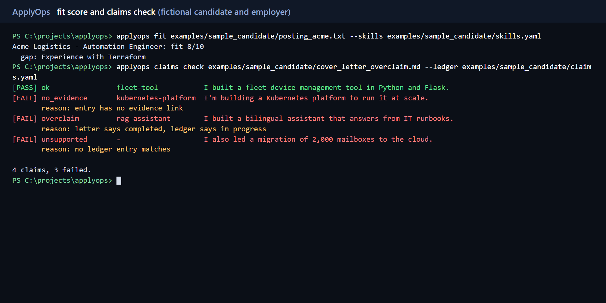
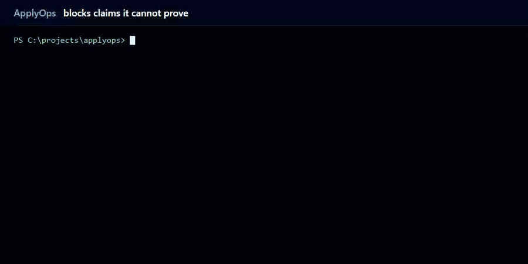
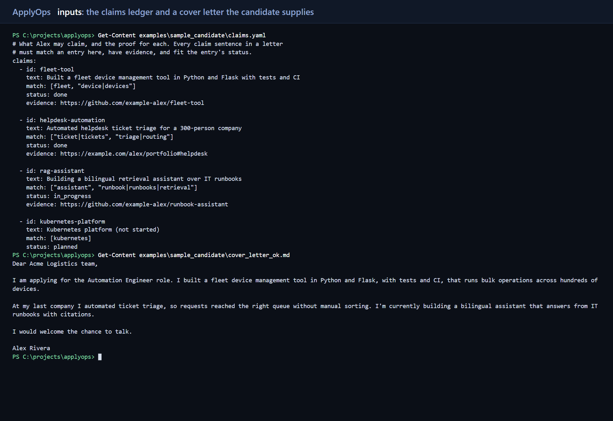
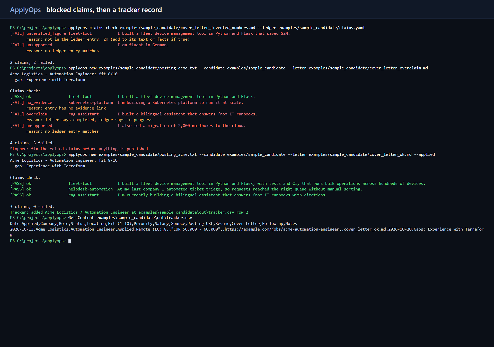
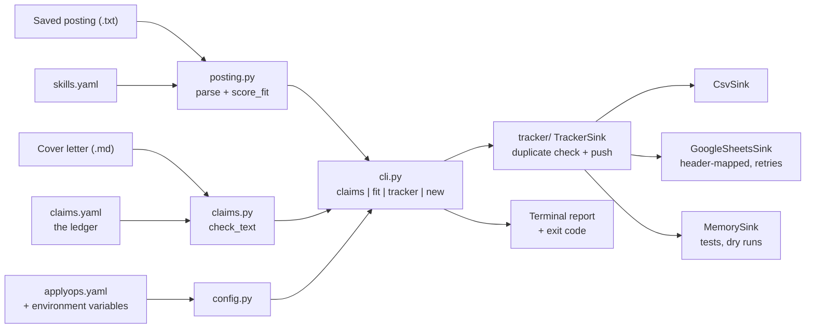

# ApplyOps

[](https://github.com/TommyChivite-23/applyops/actions/workflows/ci.yml)


**A command-line tool that checks a job application before it goes out: it scores how well a posting
fits your skills, blocks cover-letter sentences you cannot prove, and logs the application to a tracker
without duplicates.**

AI tools make cover letters fast to write, and they make it just as easy to promise things nobody has
built ("I'm building a Kubernetes platform"). ApplyOps treats those sentences like code that has to pass
a test. Every claim must match an entry in a **claims ledger** (`claims.yaml`) that has an evidence link,
a status that fits the wording, and any numbers it quotes.





**Walkthrough video (about 7 minutes, subtitles only, no audio):** [docs/media/applyops-walkthrough.mp4](docs/media/applyops-walkthrough.mp4) | [transcript](docs/media/walkthrough-transcript.md)

> **About the demo data.** Everything in this repository is fictional: the candidate (Alex Rivera), the
> employer (Acme Logistics), the posting, the ledger and the links. Real candidate files belong in a
> private folder that is never committed. See [docs/SECURITY.md](docs/SECURITY.md).

## What works today, and what does not

| Capability | Status |
|---|---|
| Claims ledger check of a cover letter (English and Spanish) | **Implemented**, tested |
| Blocks unsupported, overstated, evidence-less claims and invented numbers | **Implemented**, tested |
| Parse a saved text posting and compute a fit score with gaps | **Implemented**, tested |
| Tracker row: CSV file, in-memory, Google Sheets (header-mapped, duplicate-safe, retries) | **Implemented**; Sheets is tested against a fake API, **not yet against live Google** |
| `applyops new`: fit, claims gate, tracker row in one command | **Implemented** (takes a posting **file**, not a URL) |
| Public-repo audit script and CI claims gate | **Implemented** |
| Tailored resume and cover-letter generation | **Planned** (v0.2). ApplyOps checks a letter you supply; it does not write one |
| PDF generation and layout checks | **Planned** (v0.2) |
| `applyops new <URL>` posting fetch, Google Drive upload | **Planned** (v0.3) |

Nothing in the "Planned" rows exists in the code. See [docs/ROADMAP.md](docs/ROADMAP.md).

## 30-second demo

```powershell
# 1. A letter that stays inside the ledger: passes (exit code 0)
applyops claims check examples/sample_candidate/cover_letter_ok.md --ledger examples/sample_candidate/claims.yaml

# 2. A letter that overclaims: blocked (exit code 1)
applyops claims check examples/sample_candidate/cover_letter_overclaim.md --ledger examples/sample_candidate/claims.yaml
```

Output of the second command (real output):

```
[PASS] ok                fleet-tool           I built a fleet device management tool in Python and Flask.
[FAIL] no_evidence       kubernetes-platform  I'm building a Kubernetes platform to run it at scale.
       reason: entry has no evidence link
[FAIL] overclaim         rag-assistant        I built a bilingual assistant that answers from IT runbooks.
       reason: letter says completed, ledger says in progress
[FAIL] unsupported       -                    I also led a migration of 2,000 mailboxes to the cloud.
       reason: no ledger entry matches

4 claims, 3 failed.
```

## Commands

| Command | What it does |
|---|---|
| `applyops claims check LETTER --ledger claims.yaml` | Checks every claim sentence. Exit code `1` if any fails. |
| `applyops fit POSTING --skills skills.yaml` | Prints the fit score out of 10 and the requirements you do not cover. |
| `applyops tracker push --candidate DIR --company C --role R` | Adds one row to the tracker. Refuses duplicates. |
| `applyops new POSTING --candidate DIR [--letter LETTER] [--applied] [--dry-run]` | Fit score, then the claims gate, then the tracker row. Stops before writing anything if a claim fails. |

`POSTING` is a saved text file (see [the format](docs/USER_GUIDE.md#posting-format)). `applyops new <URL>`
is a **proposed** interface and is not implemented.

## Install (Windows)

Requires Python 3.11 or newer.

```powershell
git clone https://github.com/TommyChivite-23/applyops.git
cd applyops
py -3.12 -m venv .venv
.\.venv\Scripts\Activate.ps1
pip install -e ".[sheets,dev]"
applyops --version
```

Full steps and the Google Sheets setup: [docs/INSTALLATION.md](docs/INSTALLATION.md).
If PowerShell refuses to activate the environment, see [docs/TROUBLESHOOTING.md](docs/TROUBLESHOOTING.md).

## Quick start: run a whole application on fictional data

```powershell
applyops new examples/sample_candidate/posting_acme.txt `
  --candidate examples/sample_candidate `
  --letter examples/sample_candidate/cover_letter_ok.md --applied
```

```
Acme Logistics - Automation Engineer: fit 8/10
  gap: Experience with Terraform

Claims check:
[PASS] ok                fleet-tool           I built a fleet device management tool in Python and Flask, ...
[PASS] ok                helpdesk-automation  At my last company I automated ticket triage, ...
[PASS] ok                rag-assistant        I'm currently building a bilingual assistant that answers from IT runbooks ...

3 claims, 0 failed.
Tracker: added Acme Logistics / Automation Engineer at examples\sample_candidate\out\tracker.csv row 2
```

Run it a second time and it prints `Skipped: ... is already tracked`. The row lands in
`examples/sample_candidate/out/tracker.csv`, which is git-ignored. Use `--dry-run` to preview without
writing. The step-by-step guide is [docs/USER_GUIDE.md](docs/USER_GUIDE.md).

## The claims ledger

```yaml
claims:
  - id: rag-assistant
    text: Building a bilingual retrieval assistant over IT runbooks
    match: ["assistant", "runbook|runbooks|retrieval"]   # every term must appear in the sentence
    status: in_progress                                  # done | in_progress | planned
    evidence: https://github.com/example-alex/runbook-assistant
    facts: ["300"]                                       # optional: numbers a letter may quote
```

A sentence is checked if it is a first-person claim ("I built...", "I'm building...", "Built a..."),
a resume-style bullet, or a first-person attribute (certification, degree, years of experience, fluency).
It passes only if a ledger entry matches it, has evidence, and fits the wording:

| The letter says | The ledger entry must be | Otherwise the verdict is |
|---|---|---|
| "I built / led / automated ..." | `done` | `overclaim` |
| "I'm building / learning ..." | `done` or `in_progress` | `overclaim` (`planned` supports nothing) |
| "I hold a certification / I have 5 years ..." | `done` | `overclaim` |
| any claim with no matching entry | | `unsupported` |
| a matching entry with no evidence link | | `no_evidence` |
| a number such as `$2M` or `90%` not in the entry's `text` or `facts` | | `unverified_figure` |

**This is pattern matching, not truth detection.** It cannot know that a sentence is true, only that the
letter stays inside what you wrote in the ledger. It misses some phrasings (for example "Our team built...")
and only judges sentences it recognises as claims. The measured limits are in
[docs/SECURITY.md](docs/SECURITY.md#what-the-claims-check-cannot-do).

## Screenshots

| Fit score and claims check | Inputs: ledger and cover letter | Blocked claims, then a tracker record |
|---|---|---|
|  |  |  |

These images, the GIF and the video are rendered from the **real output** of the commands shown, run on the
fictional sample data (see [docs/media/README.md](docs/media/README.md)). ApplyOps does not generate resumes or
PDFs yet, so there is no screenshot of a generated PDF; the second image shows the ledger and the letter the
candidate supplies.
## Architecture



Only components that exist are drawn. The planned ones are in
[docs/ARCHITECTURE.md](docs/ARCHITECTURE.md), which also explains the design decisions.

## Google Sheets tracker

```yaml
# applyops.yaml in the candidate folder
tracker:
  kind: sheets
  spreadsheet_id: your-spreadsheet-id   # or env APPLYOPS_SPREADSHEET_ID
  sheet: Applications
  credentials_file: sa.json             # or env GOOGLE_APPLICATION_CREDENTIALS
```

Columns are matched by header name (extra columns and any order are fine), values are written as plain
text so nothing becomes a formula, duplicates (same company, role and date) are skipped, and HTTP 429 and
5xx responses are retried with exponential backoff. It is tested against an in-memory fake of the Sheets API;
**it has not been run against a live spreadsheet yet.**

## Testing

```powershell
pytest --cov=applyops          # 100 tests, 98% line coverage
ruff check .                   # lint
ruff format --check .          # formatting
python scripts/audit_public_repo.py   # secrets, private IPs, emails, phone numbers, personal files
```

What the tests cover is listed in [docs/TESTING.md](docs/TESTING.md). CI runs all four checks on every push
and pull request, on Python 3.11 and 3.13, plus a gate that proves the sample overclaiming letters are
blocked.

## Troubleshooting

Common errors (activation blocked, `applyops` not found, tracker errors, claims that fail unexpectedly)
are in [docs/TROUBLESHOOTING.md](docs/TROUBLESHOOTING.md).

## Security and privacy

No secrets, personal data or real tracker rows belong in this repository. Credentials come from environment
variables or a git-ignored file, and `scripts/audit_public_repo.py` runs before every publish and in CI.
Details and limits: [docs/SECURITY.md](docs/SECURITY.md).

## Current limitations

* Reads a **saved text posting**; it does not fetch a URL.
* Does **not generate** resumes, cover letters or PDFs; it checks a letter you supply.
* The claims check is pattern matching and cannot tell whether a sentence is true.
* The fit score is keyword matching against your `skills.yaml` aliases, not semantic understanding.
* Google Sheets support has not been exercised against a live spreadsheet.

## Roadmap

v0.2 document generation and PDF layout checks, v0.3 URL intake and Drive upload. See
[docs/ROADMAP.md](docs/ROADMAP.md).

## Contributing

Issues and pull requests are welcome. Start with [docs/DEVELOPMENT.md](docs/DEVELOPMENT.md): how to set up,
run the checks, and add a claim pattern or a tracker sink.

## Documentation

[User guide](docs/USER_GUIDE.md) | [Installation](docs/INSTALLATION.md) | [Architecture](docs/ARCHITECTURE.md) |
[Testing](docs/TESTING.md) | [Security](docs/SECURITY.md) | [Troubleshooting](docs/TROUBLESHOOTING.md) |
[Development](docs/DEVELOPMENT.md) | [Roadmap](docs/ROADMAP.md)

## License

MIT. See [LICENSE](LICENSE).
