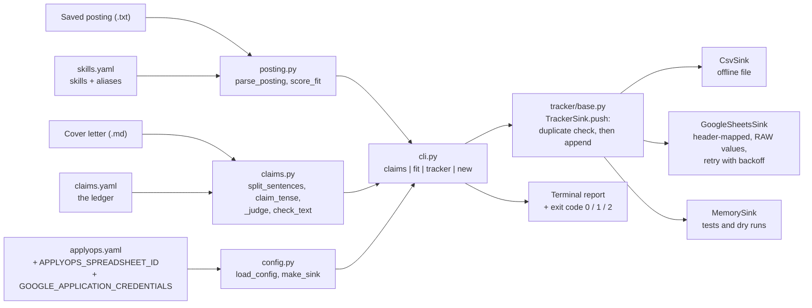
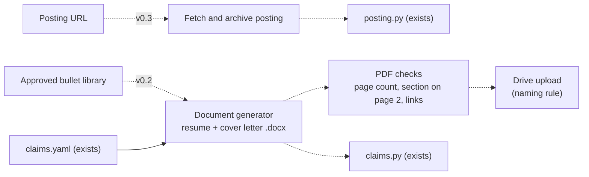

# Architecture

This page describes what the code does **today** and, separately, what is planned. Return to the
[README](../README.md).

## Current implementation (v0.1)



### Modules

| Module | Responsibility | Depends on |
|---|---|---|
| `models.py` | Plain data types: `TrackerRow` (with its duplicate `key`), `Posting`, `FitResult` | nothing |
| `posting.py` | Parse a saved posting; load skills; `score_fit` | `models` |
| `claims.py` | Load the ledger; decide whether each claim sentence is allowed | `yaml` only |
| `tracker/base.py` | `TrackerSink` interface, error types, default column names | `models` |
| `tracker/local.py` | `CsvSink`, `MemorySink` | `tracker.base` |
| `tracker/sheets.py` | `GoogleSheetsSink` and `build_service` (Google libraries imported lazily) | `tracker.base` |
| `config.py` | Read `applyops.yaml` plus environment overrides; build the right sink | `tracker` |
| `cli.py` | Parse arguments, call the modules, print the report, choose the exit code | everything above |

`claims.py` and `posting.py` do not know about the tracker or the CLI, and the tracker does not know
about claims. That separation is why each part can be tested alone.

### Data flow for `applyops new POSTING --candidate DIR --letter LETTER`

1. `load_config(DIR)` reads `applyops.yaml` (claims file, skills file, tracker settings, environment overrides).
2. `load_posting` parses `Title:` / `Company:` header lines and the bullets under a Requirements-style heading.
3. `score_fit` checks each requirement against the skill aliases. Score = `round(10 * matched / total)`.
   Unmatched requirements are the **gaps**.
4. If a letter is given, `check_text` splits it into sentences, finds the claim sentences, and judges each
   against the ledger. Any failure prints the reasons and returns exit code `1` **before the tracker is touched**.
5. A `TrackerRow` is built (follow-up date = today + 7 days). With `--dry-run` it is printed and nothing is
   written.
6. Otherwise `sink.push(row)` runs: `existing_keys()` first, and a duplicate is skipped with a message; a
   new row is appended. Tracker failures, and unreadable or invalid input files, print a message and return exit code `2`.

### How a claim is judged

```
sentence --> is it a claim?  (claim_tense: ongoing / done / stated / none)
         --> none: ignored
         --> find ledger entries whose every `match` term appears
              none            -> unsupported
              best entry has no evidence      -> no_evidence
              status too weak for the wording -> overclaim
              quotes a number not in the entry -> unverified_figure
              otherwise                       -> ok
```

"Best entry" means the one with the most `match` terms, preferring `done`.

## Design decisions

| Decision | Reason | Trade-off |
|---|---|---|
| **A sink interface** (`existing_keys`, `_append`) | One duplicate rule and one idempotent `push` for every destination; tests use `MemorySink` and a fake Sheets API | Slightly more code than writing straight to Sheets |
| **Columns matched by header name** | The spreadsheet can have extra columns, formulas and any order | A renamed header is a clear `SchemaError`, not silent misplacement |
| **`valueInputOption=RAW`** | A phone number or `7/10` is never turned into a formula or date | Dates are stored as text |
| **Retry only 429 / 500 / 503** | These are transient; a 403 or 404 will not fix itself | A permanently down API takes four attempts to report |
| **Claims by `match` terms, not an AI model** | Deterministic, free, explainable, testable in CI | Misses paraphrases; needs a well-written ledger |
| **Exit codes (0 ok, 1 claims failed, 2 bad input, config or tracker error)** | CI and scripts can gate on them | Only three states |
| **Google libraries imported lazily** | Core install needs only PyYAML | `pip install ".[sheets]"` for the Sheets sink |

## Planned (not implemented)



Dashed boxes and arrows do not exist yet. When the generator exists, its output will go through the same
claims check, so a generated letter cannot contain a claim the ledger does not allow.

Related: [Testing](TESTING.md) | [Security](SECURITY.md) | [Development](DEVELOPMENT.md)
